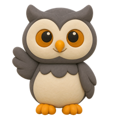

# 林小鹰

一只认真生活、偶尔宕机的灰白黏土小猫头鹰。沿用原「知核」桌宠形象，现以「林小鹰」统一管理桌宠、聊天表情和宣传资产。

## 角色基准

保持石墨灰身体、奶油白面盘与腹部、琥珀色大眼睛、赭黄色小喙与三趾脚、两个耳簇及哑光黏土质感。名称中的“小鹰”不改变其猫头鹰形象。角色用认真回应、温暖关心、疲惫和轻度自嘲表达日常聊天情绪。

账号简介：**认真生活，偶尔宕机。让林小鹰替你把话说可爱一点。**



## 资产目录

| 目录 | 内容与入口 |
| --- | --- |
| [桌宠与视频](桌宠与视频/README.md) | 原「知核」完整归档：角色原图、73 张动作帧、图集、动作预览、宣传视频、分镜、字幕、工具与过程记录 |
| [表情包01-日常营业](表情包01-日常营业/README.md) | 16 枚静态表情，原图、逐张提示词、语义清单、512/240/120 三种导出尺寸和预览 |
| [表情包02-好好过年](表情包02-好好过年/README.md) | 24 枚春节静态表情，习俗与关系语气调研、使用示例、生成原图、封面、横幅和三种尺寸导出 |
| [账号资料](账号资料/README.md) | 240 像素头像、50 像素面板图标、简介、生成母版及导出脚本 |
| [日常营业封面](表情包01-日常营业/封面/README.md) | 240×240 透明全身封面、生成原图与要求截图 |
| [日常营业横幅](表情包01-日常营业/横幅/README.md) | 750×400 无文字横幅、生成原图、裁切和导出记录 |

### 常用素材

- [头像](账号资料/avatar-240.png) · [面板图标](账号资料/icon-50.png)
- [专辑封面](表情包01-日常营业/封面/cover-240.png) · [详情横幅](表情包01-日常营业/横幅/banner-750x400.jpg)
- [全套表情预览](表情包01-日常营业/preview/contact-light.jpg) · [240 像素主图](表情包01-日常营业/exports/wechat-240/)
- [最终竖屏制作过程视频](桌宠与视频/session/outputs/zhihe-social-dark/zhihe-25min-process.mp4)
- [桌宠透明图集](桌宠与视频/assets/spritesheet.png) · [动作帧清单](桌宠与视频/assets/frames-manifest.json)
- [调研与设计依据](表情包01-日常营业/research/调研与制作方法.md)

## 历史名称与验证

2026-11-24 将根目录 `知核/` 原样迁入 `林小鹰/桌宠与视频/`；完整性记录见 [目录合并记录](目录合并记录.json)。这是目录与角色归属合并，不重画形象，也不重做已有视频。原文件中的「知核」、`zhihe`、创建时绝对路径与原始校验报告保持历史原貌，归档内相对目录结构不变。

在本目录可运行只读校验，核对桌宠归档文件的字节数与 SHA-256：

```powershell
python 桌宠与视频/verify_archive.py
```

脚本仅使用 Python 标准库。表情和配套素材的检查结果分别保存在对应目录的 `validation.json` 或 `manifest.json` 中；本地验证不等同于微信发送实测或商店审核通过。

后续专辑在本目录新增独立子目录，使用相同身份参考，并分别保存原图、提示词、配套素材和验证记录。保留已有作品和历史版本。
