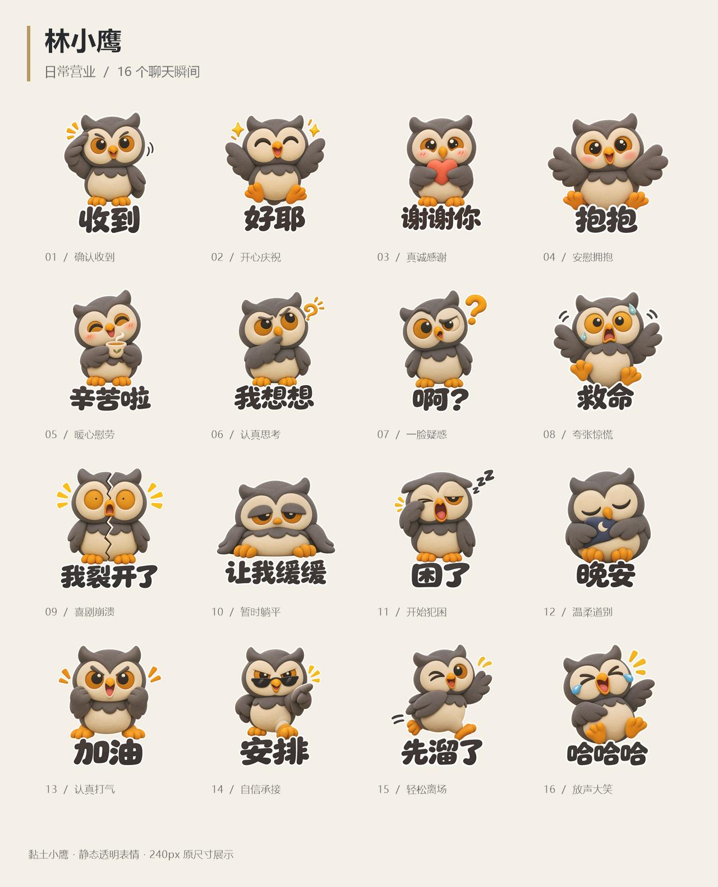

> 直接使用：[本专辑成品](../../成品/01-日常营业/README.md)，含全部静态格式及可用动图；制作历史保留如下。

> 当前使用[图文融合版](revisions/图文融合-v2/README.md)。下文保留初版记录；投稿素材由 投稿.json 的 source_dir 选择新版。

# 林小鹰 · 日常营业

16 枚静态透明表情。沿用原桌宠的灰白黏土小猫头鹰形象，给日常回应、感谢、拥抱、思考、疲惫和下班赋予不同姿态。



## 使用与入口

- [完整调研与制作方法](research/调研与制作方法.md)
- [浅色背景全套预览](preview/contact-light.jpg) · [深色背景检查](preview/contact-dark.jpg)
- [240 像素表情](exports/wechat-240/) · [512 像素通用图](exports/chat-512/) · [120 像素缩略图](exports/thumbnails-120/)
- [表情语义与来源清单](pack.json) · [技术检查](validation.json)
- [下载图片包](林小鹰-日常营业-图片包.zip)

可将独立图片保存到手机，再通过微信客户端提供的自定义表情入口添加；不同客户端的菜单与接受格式以实际界面为准。本包为静态 PNG，没有动态 GIF。尚未进行微信客户端发送实测或表情商店审核。

## 表情清单

| 编号 | 文字 | 典型回应场景 |
| --- | --- | --- |
| 01 | 收到 | 对方发来安排或信息，确认已接收 |
| 02 | 好耶 | 好消息、约定达成、一起庆祝 |
| 03 | 谢谢你 | 收到帮助或关心 |
| 04 | 抱抱 | 安慰、亲近、表达支持 |
| 05 | 辛苦啦 | 对方完成工作或分享疲惫 |
| 06 | 我想想 | 需要一点思考时间 |
| 07 | 啊？ | 轻松表达疑惑或没反应过来 |
| 08 | 救命 | 熟人聊天中的夸张惊慌 |
| 09 | 我裂开了 | 对意外结果的喜剧式崩溃 |
| 10 | 让我缓缓 | 一时疲惫或信息过载 |
| 11 | 困了 | 哈欠、睡意、降低聊天节奏 |
| 12 | 晚安 | 温柔结束一天的聊天 |
| 13 | 加油 | 鼓励朋友、同事或自己 |
| 14 | 安排 | 自信承接一个请求 |
| 15 | 先溜了 | 轻松离场、收工 |
| 16 | 哈哈哈 | 大笑、接梗 |

## 文件与复现

raw/ 保留所有选用生成原图；prompts/ 保留逐张提示词；references/ 保留原角色参考。pack.json 记录每张原图的生成来源。scripts/export.ps1 只负责等比导出、留边、预览和技术检查。

Windows PowerShell，在本目录运行：

```powershell
pwsh -File scripts/export.ps1 -OutputRoot rebuild
```

脚本默认要求输出目录尚不存在，避免覆盖交付文件。原图和已有「知核」工程没有修改。图片包包含 16 张 512px 图片、16 张 240px 图片、16 张 120px 缩略图与使用说明；完整原图及制作过程留在本工程。

## 发布文案草稿

名称：林小鹰日常

介绍：一只认真生活、偶尔宕机的小鹰。收到、抱抱、让我缓缓——让林小鹰替你把话说可爱一点。

该文字是创作草稿；未填写未经确认的版权注册信息，未投稿或发布。
